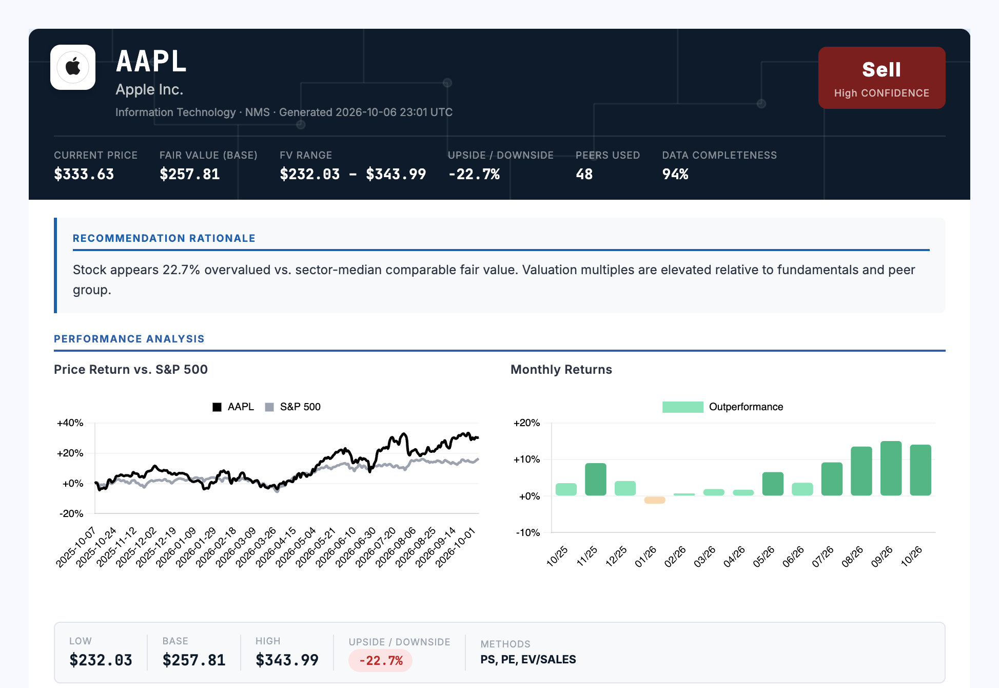

# ResearchIQ

**Automated equity research memos for S&P 500 constituents — in about 60 seconds.**

ResearchIQ takes a ticker and produces a full research memo: a valuation range, a
Buy/Hold/Sell recommendation with a confidence level, peer-benchmarked financials,
an investment thesis, risks, and catalysts. It also builds hypothetical portfolios
from an investor questionnaire using CAPM-based expected returns.

It runs entirely on a laptop. No cloud account, no paid data subscription.



*Full examples: [AAPL](docs/memo-aapl-full.png) · [MU](docs/memo-mu-full.png)*

---

## The design question

Most "AI equity research" tools ask a language model to produce numbers. That is the
wrong division of labour: a language model cannot be audited, and a valuation you
cannot trace is a valuation you cannot defend.

ResearchIQ splits the work along that line:

- **Every number is computed in Python.** Multiples, fair value ranges, TTM figures,
  sector benchmarks, portfolio weights. Deterministic, reproducible, and identical on
  every run.
- **Every recommendation follows explicit rules.** The Buy/Hold/Sell logic lives in
  `backend/analytics/recommendation.py` and can be read in a few minutes. There is no
  model deciding what to recommend.
- **The language model only writes prose.** It receives the computed results and turns
  them into narrative. It never originates a figure or a call.

The result is a memo where every claim traces back to something you can check — and
one that still degrades gracefully: with no API key configured, the narrative falls
back to templates and everything else works unchanged.

---

## Pipeline

Seven stages, one module each, in `backend/agents/`:

| Stage | Module | Does |
|---|---|---|
| 1 | `ticker_resolver.py` | Resolves and validates the ticker |
| 2 | `data_retrieval.py` | Pulls prices, financials, and company data |
| 3 | `financial_processor.py` | Computes TTM figures and ratios |
| 4 | `valuation_agent.py` | Comparable-multiple valuation against sector peers |
| 5 | `research_writer.py` | Generates the narrative |
| 6 | `report_composer.py` | Assembles the memo |
| 7 | `qa_guardrail.py` | Checks the output before it is returned |

Valuation uses P/E, P/B, P/S, P/FCF and EV/EBITDA with sector-specific weighting,
benchmarked against up to 40 sector peers. The portfolio builder uses CAPM expected
returns with a bounded valuation alpha, and a beta-weighted risk model with an
idiosyncratic component.

`SYSTEM_OVERVIEW.md` has the full architecture. `METHODOLOGY.md` covers the
valuation formulas, the recommendation thresholds, findings and references.

---

## What a memo contains

- Company description and revenue model
- Current price against a low/base/high fair value range, with upside or downside
- Buy/Hold/Sell recommendation, confidence level, and the rationale behind it
- One-year price chart against the S&P 500, plus monthly relative returns
- Financial metrics benchmarked against sector peers
- Investment thesis, key risks, and catalysts

---

## Running it

Requires Python 3.9 or newer and an internet connection.

```bash
git clone https://github.com/laraibnisarsoomro/ResearchIQ.git
cd ResearchIQ
./setup.sh
python run.py
```

Then open <http://localhost:8000>.

`setup.sh` creates a virtual environment in `.venv/`, installs dependencies, and
copies `.env.example` to `.env`. It takes two or three minutes the first time.
`Ctrl + C` stops the app.

**Optional — LLM narratives.** The app works without an API key, using template prose.
For generated narratives, put an Anthropic API key in `.env`:

```
ANTHROPIC_API_KEY=sk-ant-...
```

Restart afterwards; `.env` is read at startup. A memo costs roughly $0.01–0.03.

**Windows:** run the steps in `setup.sh` manually —

```powershell
python -m venv .venv
.venv\Scripts\activate
pip install -r requirements.txt
copy .env.example .env
python run.py
```

---

## Troubleshooting

**`./setup.sh: permission denied`** — run `chmod +x setup.sh` first.

**"No candidates available" when building a portfolio** — the cache is empty.
Generate a few memos first, or run `python seed_portfolio_data.py` to seed data for
around 150 tickers (about five minutes).

**Port 8000 in use** — change the port on the last line of `run.py`.

---

## Limitations

- **Data source.** Market data comes from Yahoo Finance via `yfinance`, which is free
  but unaudited. Figures can be stale, restated, or missing, particularly for smaller
  constituents.
- **Valuation method.** Comparable multiples only. No DCF, no dividend discount model.
  A company is valued against its sector peers, so a sector that is uniformly
  mispriced will produce uniformly mispriced fair values.
- **No qualitative judgement.** Management quality, competitive moat, regulatory risk,
  and accounting quality are not modelled. A memo is a starting point for analysis,
  not a substitute for it.
- **Point-in-time.** No backtesting, and no track record of realised accuracy.

---

## Disclaimer

This is an educational and research project. Nothing it produces is investment advice,
a recommendation to buy or sell any security, or an offer or solicitation of any kind.
Outputs are generated automatically from unaudited public data and have not been
reviewed by any registered investment adviser. Do not rely on them for investment
decisions. The author accepts no liability for any use of this software or its output.

---

## License

MIT — see `LICENSE`.

Built by [Laraib Nisar Soomro](https://github.com/laraibnisarsoomro).
